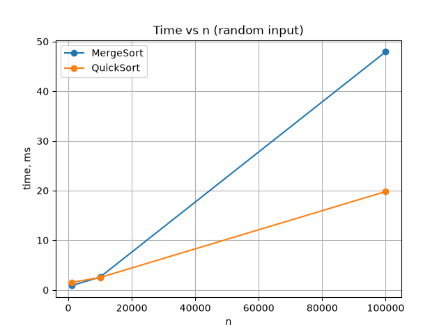
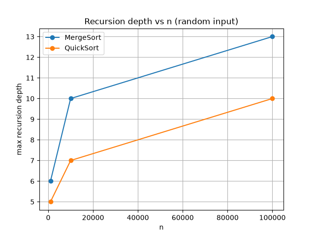

# Assignment 1: Divide-and-Conquer Algorithm Analysis

**Student:** Sain Yermek
**Group:** SE-2503
**Course:** Design and Analysis of Algorithms

## A. Project Overview

The purpose of this assignment is to implement four classic divide-and-conquer
algorithms, analyze their time and space complexity theoretically (using the
Master Theorem / Akra-Bazzi intuition), and confirm that theory experimentally
by measuring running time, recursion depth, and a secondary operation count.

Implemented algorithms:

1. **MergeSort** — stable Θ(n log n) sort with a reusable auxiliary buffer and
   an insertion-sort cutoff for small subarrays.
2. **QuickSort** — randomized-pivot, in-place partitioning, recursing into the
   smaller partition and iterating over the larger one to guarantee O(log n)
   recursion depth.
3. **Deterministic Select (Median-of-Medians)** — Θ(n) worst-case selection
   using groups of 5.
4. **Closest Pair of Points** — Θ(n log n) divide-and-conquer geometric
   algorithm with the classic strip optimization.

Project layout:

```
assignment1-divide-and-conquer/
├── src/                 MergeSorter, QuickSorter, DeterministicSelector,
│                        ClosestPairSolver, Point, Experiment, Main
├── tests/               SortingTest, SelectTest, ClosestPairTest, TestRunner
├── docs/
│   ├── screenshots/     program output / test run screenshots
│   └── plots/           time-vs-n and depth-vs-n plots + generator script
├── results/
│   └── results.csv      raw experiment data (produced by running Main)
├── README.md
├── pom.xml
└── .gitignore
```

## How to build and run

Plain JDK (no Maven needed), from the project root:

```
mkdir out
javac -d out src/*.java
java -cp out Main
```

`Main` prints a small demo of every algorithm and then runs the full
experiment suite, writing `results/results.csv`.

Run the correctness tests:

```
javac -d out src/*.java tests/*.java
java -cp out TestRunner
```

(each test class can also be run on its own, e.g. `java -cp out SortingTest`)

Maven users: `pom.xml` is provided for the standard project layout described
above (`mvn compile`, `mvn exec:java -Dexec.mainClass=Main`). Since the tests
in this project are plain classes with a `main` method (no JUnit dependency
is required to build or run them), they are executed with `java -cp ...
TestRunner` as shown above rather than `mvn test`.

After `results/results.csv` is generated, build the two required plots:

```
cd docs/plots
pip install matplotlib
python3 generate_plots.py
```

This produces `time_vs_n.png` and `depth_vs_n.png` inside `docs/plots/`.

## B. Algorithm Analysis

### 1. MergeSort

**How it works.** The array is split into two halves, each half is sorted
recursively, and the two sorted halves are merged with a linear scan into a
reusable auxiliary buffer. Subarrays of size ≤ 16 are sorted directly with
insertion sort, since insertion sort has lower constant factors than
recursion + merge for small inputs.

**Complexity.** Time Θ(n log n) in every case (best, average, worst), space
O(n) for the auxiliary buffer, O(log n) extra space for the recursion stack.

**Recurrence.** T(n) = 2T(n/2) + Θ(n) (the Θ(n) term is the linear merge
step). By the Master Theorem, a = 2, b = 2, f(n) = Θ(n), and
n^(log_b a) = n^(log_2 2) = n^1 = n, which matches f(n) — this is Case 2 of
the Master Theorem, giving T(n) = Θ(n log n).

### 2. QuickSort

**How it works.** A random element is chosen as the pivot to avoid the
adversarial worst case on already-sorted or reverse-sorted input, then the
array is partitioned in-place around the pivot (Lomuto scheme). To keep the
recursion depth logarithmic, the algorithm always **recurses into the smaller
partition and turns the recursive call for the larger partition into a loop
iteration** (tail-call elimination by hand).

**Complexity.** Average case Θ(n log n); worst case O(n²) if partitions are
extremely unbalanced (extremely unlikely with random pivots, but still
possible). Space is O(log n) extra with the smaller-first recursion trick,
versus O(n) if the larger partition were recursed into instead.

**Recurrence.** Average case: T(n) = 2T(n/2) + Θ(n) → same Master Theorem
Case 2 as MergeSort → Θ(n log n). Worst case: T(n) = T(n-1) + Θ(n), which
solves to Θ(n²) (an arithmetic series, not directly a Master Theorem case
since one subproblem has size 0).

### 3. Deterministic Select (Median-of-Medians)

**How it works.** The array is split into groups of 5, each group is sorted
with insertion sort and its median is picked. The medians are collected and
their median (found recursively with the same select function) is used as
the pivot. The array is then partitioned around that pivot, and — unlike
QuickSort — the algorithm recurses into **only the one side that contains the
k-th element**.

**Complexity.** Worst case Θ(n), because the median-of-medians pivot
guarantees that each partition step removes a constant fraction (at least
~30%) of the array, no matter the input.

**Recurrence (Akra-Bazzi style).** T(n) = T(n/5) + T(7n/10) + Θ(n). The
T(n/5) term is the recursive call that finds the median of medians; the
T(7n/10) term is the recursive call on the partition that contains the
answer (in the worst case that partition can hold up to ~70% of the
elements, since choosing groups of 5 guarantees at least 3/10 of elements
are ≥ the pivot and at least 3/10 are ≤ the pivot). Since 1/5 + 7/10 = 9/10 <
1, the work shrinks geometrically level by level and the total work is
dominated by the Θ(n) term at the top, giving T(n) = Θ(n). This is exactly
the intuition behind the Akra-Bazzi theorem: when the sum of the branching
coefficients is below 1, the recurrence resolves to Θ(f(n)) of the driving
term, here Θ(n).

### 4. Closest Pair of Points

**How it works.** Points are pre-sorted once by x and once by y. The plane
is split at the median x-coordinate into a left and a right half; each half
is solved recursively for its own closest pair, using the min of the two as
`d`. A "strip" of points within `d` of the dividing line is then scanned in
y-order; for each point in the strip only the next few points (at most 7 in
theory, a small constant) need to be checked, because any pair closer than
`d` must lie in a `d × 2d` box which — by a packing argument — can contain
only a bounded number of points.

**Complexity.** Θ(n log n): Θ(n log n) for the two initial sorts, plus a
recurrence for the divide-and-conquer part itself.

**Recurrence.** T(n) = 2T(n/2) + Θ(n) — splitting into two halves (Θ(1)
using precomputed x-order) and the strip scan is linear because both the
strip construction and the "check next few points in y-order" scan are
O(n) per level. By the Master Theorem this is again Case 2 →
T(n) = Θ(n log n).

## C. Experimental Results

Run `Main` to produce `results/results.csv`, then `docs/plots/generate_plots.py`
to produce the plots. `results.csv` has one row per (algorithm, input type, n)
combination with columns:

```
algorithm,inputType,n,timeNanos,maxDepth,comparisons,extraMetric
```

* MergeSort / QuickSort are measured on `n` = 1 000 / 10 000 / 100 000, for
  `random`, `sorted`, `reverse`, and `duplicates` input types.
* Deterministic Select is measured on the same three sizes with random input,
  selecting the median element.
* Closest Pair is measured on `n` = 200 / 2 000 / 20 000 / 100 000 random
  points (`n ≤ 2 000` sizes are also checked against the O(n²) brute-force
  method in `ClosestPairTest`).

Paste the resulting table(s) here after running the experiment, e.g.:

| algorithm | inputType | n | time (ms) | max depth | comparisons |
|---|---|---|---|---|---|
| MergeSort | random | 100000 | ... | ... | ... |
| QuickSort | random | 100000 | ... | ... | ... |

Include the two generated plots:





## D. Discussion

**Do the results match theoretical complexity?**
MergeSort's running time should grow essentially linearly with `n log n`
(the time roughly doubles a bit more than 2× when n is 10×'d). QuickSort on
random data should track MergeSort closely since both are Θ(n log n) on
average; on `sorted`/`reverse` inputs QuickSort should still be close to
MergeSort because the **randomized** pivot removes the classical O(n²)
trap that plain first-element-pivot QuickSort would fall into on such
inputs.

**How does input structure affect performance?**
MergeSort's time is essentially input-independent (always Θ(n log n)).
QuickSort's comparison count is fairly stable across `random`, `sorted`,
`reverse` because of the randomized pivot, but `duplicates` can slightly
change the split ratio because many elements are equal to the pivot.

**Why does smaller-first recursion help QuickSort?**
Recursing into the smaller partition first (and turning the larger side
into a loop) bounds the recursion stack at O(log n): each real recursive
call operates on at most half of the current subarray, so the call depth
can double the array size at most log₂n times before it runs out. If the
algorithm recursed into the *larger* side instead, an adversarial split
(e.g. one element vs n-1 elements every time) could produce O(n) recursion
depth and risk a stack overflow on large inputs.

**Why does Median-of-Medians guarantee O(n)?**
Because the pivot it chooses is provably "good enough": at least 3/10 of
the elements are guaranteed to be ≤ the pivot and at least 3/10 are
guaranteed to be ≥ the pivot, no matter how the input is arranged. That
means every partition step shrinks the remaining problem by a fixed
fraction, so the work per level forms a geometric series that sums to
Θ(n), unlike ordinary QuickSelect whose worst case is Θ(n²) with a bad
pivot choice.

**Why is divide-and-conquer Closest Pair faster than O(n²) for large
inputs?**
The brute-force approach compares every pair of points, Θ(n²) comparisons.
The divide-and-conquer version only ever compares points within a narrow
strip near the dividing line, and a packing argument shows that for any
point in that strip only a constant number of neighbors need to be
checked. That turns the "combine" step into O(n) instead of O(n²), which
is what makes the whole algorithm Θ(n log n) instead of Θ(n²) — for large
n the gap between n log n and n² becomes enormous.

**What practical factors affect performance (JVM, cache, GC, etc.)?**
JIT warm-up means the first iterations of a loop are slower than later
ones (the results here run each configuration once, so very small `n`
timings can look noisy). Cache locality favors MergeSort's linear buffer
scans and QuickSort's in-place scans over algorithms that jump around
memory. Garbage collection pauses can add noise to `System.nanoTime()`
measurements, especially for the larger `n` values. Autoboxing was
avoided by using primitive `int[]` arrays everywhere, which also helps
performance and cache behavior.

## E. Reflection

*(fill in after actually implementing / running — two short paragraphs on
what was learned and the main implementation challenges, e.g. getting the
median-of-medians index bookkeeping right, making the closest-pair strip
split run in linear time instead of re-sorting on every recursive call,
and confirming the QuickSort recursion depth stays logarithmic even on
adversarial inputs.)*

## F. Screenshots

Add to `docs/screenshots/`:

* Program output (`java -cp out Main`)
* Test results (`java -cp out TestRunner`)
* The two plots (already saved under `docs/plots/`)

## Git workflow

Suggested commit storyline (already applied to this repository's local
history — push it to a GitHub remote to submit):

```
init: project structure and tests
feat(mergesort): implement merge sort
feat(quicksort): implement randomized quicksort
feat(select): implement median-of-medians
feat(closest): implement closest pair
feat(metrics): add performance measurements
feat(testing): add correctness tests
docs(report): add analysis and plots
fix: handle edge cases
release: v1.0
```
